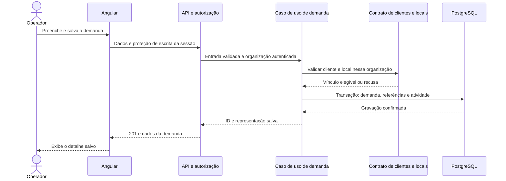

# Primeira entrega operacional — desenho técnico proposto

**Estado:** proposta para revisão, vinculada a [spec.md](spec.md) e às decisões confirmadas de [context.md](context.md).
**Base:** [AD-001](../../../docs/decisions/0001-base-tecnica-aprovada.md). Não há código existente para reaproveitar.

## Organização lógica

| Área | Responsabilidade e dados sob sua gestão | Contrato usado por outras áreas |
| --- | --- | --- |
| Acesso e organizações | Organização, conta Identity, vínculo organizacional, perfil e sessão | Contexto autenticado; autorização; consulta de responsável elegível |
| Clientes e locais | Cliente e locais de atendimento | Consulta e validação de cliente/local pertencentes à organização |
| Demandas | Demanda, referências externas, autoria e atividades | Criação, alteração e leitura da demanda |

Uma API e um PostgreSQL atendem ao primeiro recorte. As fronteiras são lógicas; uma área não altera os registros internos de outra. A organização física dos projetos será definida na estruturação, respeitando as responsabilidades de domínio, aplicação, infraestrutura e transporte da Clean Architecture, com casos de uso agrupados por funcionalidade.



## Modelo de dados conceitual

| Registro | Campos relevantes | Vínculos / restrições |
| --- | --- | --- |
| Organização | ID, nome, ativo | Fronteira de escopo; provisionamento conforme D03 |
| Conta | ID Identity, nome, e-mail, estado da credencial inicial | Credencial protegida pelo mecanismo Identity; sem senha em logs ou respostas |
| Vínculo organizacional | Organização, usuário, perfil-base, ativo | Resolve o contexto autenticado; a interface desta entrega trabalha em um único contexto por sessão |
| Cliente | ID, organização, nome, documento opcional, instruções, autoria e datas | Sem unicidade por nome; organização resolvida pelo servidor |
| Local | ID, organização, cliente, nome, endereço obrigatório, instruções opcionais, autoria e datas | Pertence ao cliente da mesma organização |
| Demanda | ID, organização, cliente, local, descrição, origem, responsável opcional, prioridade opcional (Baixa/Média/Alta), status (inicial Recebida), versão, autoria e datas | Cliente/local válidos; versão para conflito de edição |
| Referência da demanda | ID, organização, demanda, tipo, valor | Tipos iniciais chamado e ordem de compra; pesquisa sem unicidade global |
| Atividade da demanda | ID, organização, demanda, ação, autor, data e alterações relevantes | Historial de criação/alteração persistido com a demanda |

Os campos e limites seguem a spec. UUIDs, nomes físicos, bibliotecas de persistência e versão exata dos frameworks serão concretizados na tarefa de estruturação; não há migração criada nesta fase. O modelo precisa assegurar vínculos coerentes no banco além das validações de aplicação, conforme o mapeamento escolhido.

O ID é a identificação interna pesquisável nesta proposta. Um número sequencial amigável não foi solicitado e não será inferido como obrigatório. A versão de concorrência pertence ao contrato de alteração, não ao formulário editável.

## Sessão e provisionamento

- Aplicar Identity e cookies conforme a arquitetura; preferir mesma origem e proteger as escritas contra CSRF.
- Resolver a organização no servidor a partir de vínculo ativo e confiável. Um ID enviado no corpo ou query não concede acesso a outra organização.
- Preparar organização e primeiro Administrador por mecanismo controlado e idempotente, executado apenas quando solicitado no ambiente correspondente. Credenciais não ficam na especificação ou no repositório.
- O Administrador cadastra contas da equipe com perfil-base. Conforme D08, a senha temporária definida pelo Administrador obriga a troca antes do uso operacional; entrega da credencial acontece fora da plataforma.
- O vínculo de conta com mais de uma organização e a seleção/troca entre organizações não são capacidades desta interface inicial. A estruturação deve explicitar como o provisionamento mantém o contexto inequívoco sem inventar um acesso administrativo entre empresas.
- Não persistir uma identidade organizacional arbitrária escolhida pelo navegador como fonte de autorização. Revalidar acesso quando conta ou vínculo forem desativados.

## Contratos HTTP propostos

As rotas são propostas de implementação. Os DTOs respeitam os campos da spec; entradas operacionais não recebem organização, autoria, datas de sistema ou senha em respostas.

| Método e rota | Entrada / filtros | Resultado de sucesso | Regra de acesso |
| --- | --- | --- | --- |
| `POST /api/auth/login` | E-mail e senha | Sessão; informa necessidade de troca inicial | Público; limite de tentativas definido na estruturação |
| `GET /api/auth/me` | Sessão | Usuário, organização e permissões efetivas | Conta e vínculo ativos |
| `POST /api/auth/logout` | Sessão e antifalsificação | 204 | Usuário da sessão |
| `POST /api/auth/change-password` | Senha atual e nova | 204; encerra condição de troca inicial | Usuário da sessão |
| `GET /api/users` | Paginação | Usuários da organização | Administrador |
| `GET /api/users/eligible-assignees` | Identidade da sessão | Lista de `id` e `displayName` de usuários ativos da organização | Três perfis; operação de demandas |
| `POST /api/users` | Nome, e-mail, perfil e credencial inicial | 201 | Administrador |
| `PUT /api/users/{id}` | Nome, perfil e ativo | 200; preserva último administrador | Administrador |
| `GET /api/customers` | `q`, `page`, `pageSize` | Página de clientes | Três perfis |
| `GET /api/customers/{id}` | ID | Cliente | Três perfis |
| `POST /api/customers` | Nome, documento e instruções | 201 | Administrador e Gestor |
| `PUT /api/customers/{id}` | Dados descritivos | 200 | Administrador e Gestor |
| `GET /api/customers/{id}/locations` | Cliente | Lista de locais desse cliente | Três perfis |
| `GET /api/customers/{id}/locations/{locationId}` | Cliente e local | Local | Três perfis |
| `POST /api/customers/{id}/locations` | Nome, endereço e instruções | 201 | Administrador e Gestor |
| `PUT /api/customers/{id}/locations/{locationId}` | Dados descritivos | 200 | Administrador e Gestor |
| `POST /api/demands` | Campos da demanda e referências opcionais | 201; ID, prioridade e status inicial Recebida | Três perfis |
| `PUT /api/demands/{id}` | Dados básicos e versão conhecida | 200; dados e nova versão | Três perfis |
| `GET /api/demands` | `q`, cliente, local, responsável, `page`, `pageSize` | Página de demandas | Três perfis |
| `GET /api/demands/{id}` | ID | Dados salvos e atividade da demanda | Três perfis |

A API de responsáveis oferece `GET /api/users/eligible-assignees`, contrato restrito que retorna somente ID e nome de usuários ativos da organização para os três perfis. A tela do seletor será integrada em T14/T22; a API não usa a listagem administrativa nem expõe e-mail/perfil da equipe ao Operador. A implementação de T12 e sua verificação estão em [verification.md](verification.md).

## Consulta, respostas e concorrência

- Paginação proposta: página inicial 1, tamanho padrão 20 e máximo 100; parâmetros inválidos retornam 400. Ordenação de demandas por criação decrescente com desempate por ID. A busca e os totais são calculados no backend após o escopo organizacional.
- Busca textual proposta: comparação sem distinção de maiúsculas/minúsculas por trecho; busca de ID interno por igualdade quando o termo for um ID válido. Não depender de carregar todos os registros no navegador.
- 400: campo/formato inválido ou local que não pertence ao cliente autorizado; resposta com erros de campo.
- 401: ausência de sessão válida; a API não retorna a página HTML de login no lugar de JSON.
- 403: sessão válida sem permissão para a ação.
- 404: recurso inexistente no escopo da organização, inclusive tentativas por ID de outra organização. A validação de vínculo não revela a existência do registro fora do escopo.
- 409: versão de demanda desatualizada, tentativa de retirar o último Administrador ativo ou conflito de identidade no cadastro da equipe; mensagem sem revelar uma eventual conta de outra organização.
- Falha interna: identificador de correlação para diagnóstico e mensagem adequada na interface, sem retornar credenciais ou detalhes de infraestrutura.
- Edição usa comparação da versão recebida com a persistida. Um conflito mantém a versão atual e exige recarga; o cliente não repete a gravação automaticamente.
- A transação de demanda inclui referências e atividade. As consultas de elegibilidade devem observar a mesma organização e preservar a consistência da gravação.

## Interface funcional proposta

| Tela | Ações e conteúdo | Estados relevantes |
| --- | --- | --- |
| Entrar / trocar senha inicial | Informar credenciais, mostrar falha genérica, concluir troca exigida | Enviando, falha de acesso, falha de rede |
| Estrutura autenticada | Identificar organização e usuário; acessar áreas e sair | Sessão expirada, acesso negado |
| Equipe | Administrador lista, cadastra e altera perfil/ativo | Vazia, salvando, erro, último administrador |
| Clientes e locais | Lista e busca; detalhe do cliente; locais; ações de edição conforme perfil | Vazio, carregando, erro e formulário inválido |
| Nova demanda | Cliente → local; descrição; origem; responsável opcional; referências opcionais; prioridade opcional em lista Baixa/Média/Alta | Sem clientes/locais disponíveis, enviando, erro de campo |
| Demandas | Busca, filtros, paginação; ID, cliente, local, descrição resumida, origem, responsável e criação | Vazia, sem correspondência, carregando, falha |
| Detalhe/edição de demanda | Dados persistidos e atividade; alterar dados básicos | Acesso inexistente, conflito de versão, erro ao salvar |

Esboço de navegação, sem impor identidade visual:

```text
Entrar -> [Troca inicial, quando exigida] -> Demandas
                                           |-- Nova demanda -> Detalhe -> Editar
                                           |-- Clientes -> Cliente -> Locais
                                           |-- Equipe (Administrador)
                                           `-- Sair
```

Ao faltar um cadastro necessário, Administrador/Gestor têm acesso ao cadastro correspondente; Operador recebe orientação para solicitar o cadastro a um desses perfis. Os esboços definem ações e resultados, não uma referência visual aprovada.

## Riscos e decisões da estruturação

| Ponto | Impacto | Tratamento |
| --- | --- | --- |
| Ausência de runtime e testes | Não há comandos reais a reutilizar | T01 estabelece execução, build e testes; tarefas seguintes registram os comandos existentes |
| Escolha complementar de persistência e componentes | Bibliotecas e nomes ainda não estão fechados | Verificar versões/suporte quando implementar; documentar a escolha sem alterar AD-001 |
| Dados manipulados entre organizações | Exposição ou gravação indevida | Testes com duas organizações e validação de vínculos em todas as operações relevantes |
| Duplo cadastro após perda de resposta | Duas demandas podem ser criadas por nova ação manual | Bloqueio de envio simultâneo na UI e mensagem de conferência; deduplicação por ticket é inadequada ao modelo |
| Mutação de permissão enquanto há sessão | Acesso antigo poderia permanecer | Definir mecanismo de invalidação/revalidação de conta e vínculo em T03/T04; testar revogação |
| Preferência visual ainda ausente | Possível ajuste de apresentação | Usar esboços funcionais e revisar telas com o usuário antes de declarar validação visual |

Não há dívida ou comportamento de código existente avaliado nesta fase. O desenho é uma proposta; os cenários de teste e as dependências de execução estão em [tasks.md](tasks.md).
