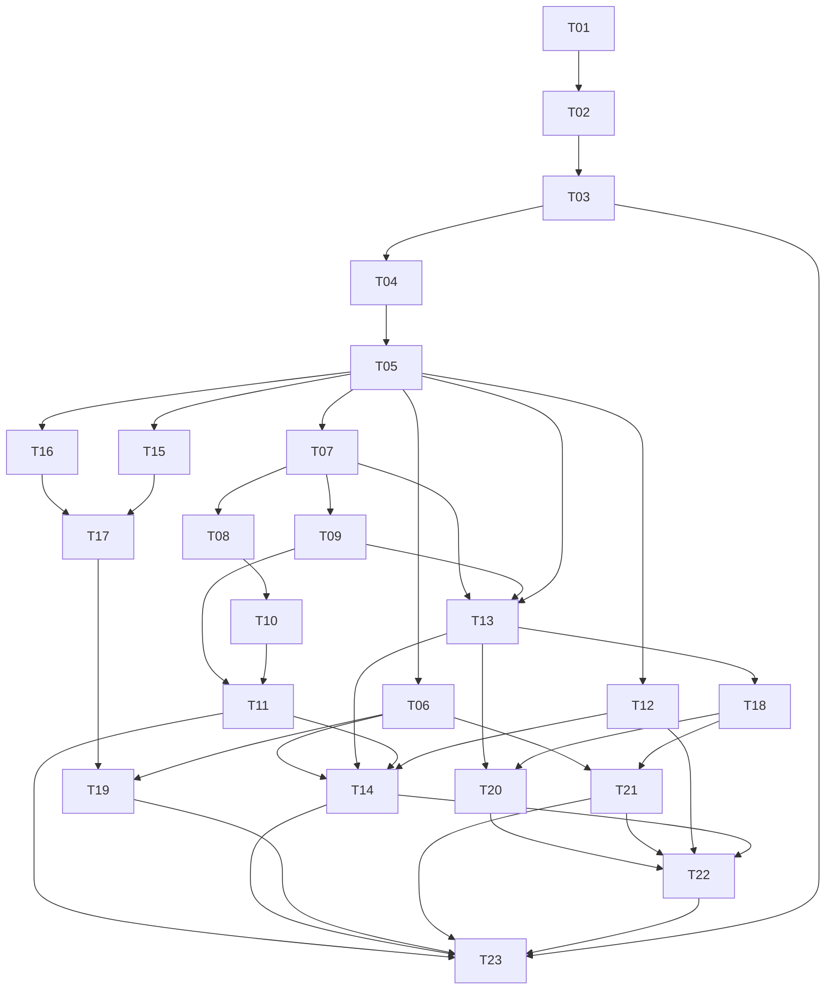

# Primeira entrega operacional — plano de tarefas

**Estado:** escopo aprovado para implementação em 05/11/2026; T01–T17 concluídas; T18 é a próxima.
**Fontes:** [spec.md](spec.md), [design.md](design.md) e decisões confirmadas em [context.md](context.md).
**Autorização atual:** implementação local aprovada em 05/11/2026; o usuário solicitou inicializar Git e enviar para `ccjunior/pit-crm` em 05/11/2026.
**Approved**: 2026-11-05 - user: "aprovo"

## Protocolo de execução

Use a entrada local da `tlc-spec-driven` e as skills da área envolvida. Cada tarefa inclui os testes e verificações do comportamento que introduz; a conferência final integra evidências e testa o fluxo completo, sem postergar todos os testes para o fim.

Os caminhos executáveis concretizados por T01 são `backend/src/`, `backend/tests/` e `frontend/`; configuração local do banco fica em `docker-compose.yml` e `.env.example`. Os comandos e versões reais estão no README e na arquitetura técnica.

Uma única execução pode seguir a ordem numérica. Se houver delegação autorizada, respeite dependências e defina arquivos de responsabilidade antes de dividir trabalhos; nenhum agente foi delegado nesta etapa.

## Plano de execução

## Tarefas e critérios de conclusão

Cada linha identifica um resultado verificável, uma área responsável e dependências explícitas. Os comandos passam de “a definir” para o comando real em T01 ou na criação da suíte correspondente.

| Tarefa | Entrega e área responsável | Depende de | Critérios | Concluir quando / verificação |
| --- | --- | --- | --- | --- |
| T01 | Estrutura executável da API .NET, frontend Angular, configuração local de PostgreSQL e infraestrutura mínima de testes — base técnica | Nenhuma | Habilita todos | API e frontend iniciam localmente; banco é acessível no ambiente de desenvolvimento; build e uma verificação real de cada runtime passam; versões, comandos e variáveis sem segredos estão documentados |
| T02 | Persistência inicial de organização, conta e vínculo — backend | T01 | PEO-01, PEO-21 | Schema e migrações aplicam no banco de teste; vínculo não aponta para organização inexistente; organização de uma conta não é escolhida por dados operacionais do navegador |
| T03 | Provisionamento controlado e repetível do primeiro Administrador — backend | T02 | PEO-01 | Teste demonstra primeira execução e repetição sem duplicar organização/conta nem sobrescrever credencial; nenhuma senha é gravada em código ou logs |
| T04 | API de entrada, sessão atual, saída e proteção de escritas — backend | T03 | PEO-02, PEO-03, PEO-04, PEO-25 | Testes de integração demonstram login válido/inválido, sessão, saída, 401/403, proteção de escrita e revalidação de vínculo/conta desativados |
| T05 | Políticas e matriz inicial de autorização — backend | T04 | PEO-05, PEO-08, PEO-11, PEO-21, PEO-25 | Testes das ações por perfil passam; a chamada direta da API não depende da ocultação dos botões; vínculo da organização é aplicado antes de consulta/alteração |
| T06 | Entrada e estrutura autenticada com organização identificada — frontend | T05 | PEO-02, PEO-03, PEO-04, PEO-24, PEO-25, PEO-26 | Interface integra a sessão real, mostra falha genérica, mantém navegação protegida e permite sair; testes dos estados e inspeção por teclado |
| T07 | API de criação, detalhe e busca de clientes — backend | T05 | PEO-08, PEO-10, PEO-15, PEO-21 | Cadastro válido persiste; buscas paginadas retornam apenas dados e totais da organização; Operador não grava; limites e IDs de outra organização são testados |
| T08 | API de alteração de cliente preservando vínculos — backend | T07 | PEO-09, PEO-15, PEO-21 | Alteração mantém ID e locais/demandas existentes; entrada inválida ou acesso de outra organização não altera dados |
| T09 | API de cadastro, detalhe e consulta de locais por cliente — backend | T07 | PEO-11, PEO-12, PEO-15, PEO-21 | Valida vínculo com cliente e organização; lista por cliente; rejeita Operador na gravação; casos positivos e negativos cobertos |
| T10 | Listagem, busca e formulário de clientes — frontend | T08 | PEO-08, PEO-09, PEO-10, PEO-24, PEO-26 | Administrador/Gestor cadastram e editam usando API real; Operador consulta; estados vazio/erro/carregamento e validação funcionam |
| T11 | Interface de locais dentro do cliente — frontend | T09, T10 | PEO-11, PEO-12, PEO-24, PEO-26 | Lista e formulários usam o cliente correto; acesso por perfil é respeitado; cenários com vários locais e nenhum local são verificados |
| T12 | API restrita de responsáveis elegíveis — backend | T05 | PEO-16, PEO-21 | Retorna somente ID e nome dos usuários ativos elegíveis da organização para os três perfis; não usa a listagem administrativa de contas |
| T13 | Criação de demanda com referências e atividade atômicas — backend | T07, T09, T05 | PEO-13, PEO-14, PEO-15, PEO-16, PEO-21, PEO-22 | Testes incluem responsável ausente, chamado/OC ausentes ou repetidos, vínculo cliente/local incorreto, usuário de outra organização e falha transacional sem persistência parcial |
| T14 | Formulário de nova demanda integrado à API — frontend | T06, T13, T11, T12 | PEO-12, PEO-13, PEO-15, PEO-23, PEO-24, PEO-26 | Seleção cliente/local funciona; gravação sem responsável é possível; campos inválidos preservam preenchimento; envio simultâneo bloqueado e falha de resposta não reenvia automaticamente |
| T15 | API de listagem administrativa e criação de equipe — backend | T05 | PEO-05, PEO-06, PEO-21 | Somente Administrador acessa; conta pertence à organização; credencial inicial não retorna em listagens; conflitos não revelam dados externos |
| T16 | API de troca obrigatória de senha inicial e senha própria — backend | T05 | PEO-06, PEO-25 | Antes da troca, apenas as operações necessárias de conta são permitidas; após a troca, a matriz operacional é aplicada; testes não expõem senhas |
| T17 | API de alteração de conta/perfil e proteção do último Administrador — backend | T16, T15 | PEO-05, PEO-07, PEO-21 | Edição limita-se à organização; desativação/redução do último Administrador é recusada; duas alterações concorrentes não eliminam todos os administradores |
| T18 | API de busca paginada e detalhe de demandas — backend | T13 | PEO-17, PEO-18, PEO-21 | Busca por ID/referências/descrição e filtros operam no backend; totais, paginação, ausência de responsável e tentativas por ID externo são verificados |
| T19 | Interface de equipe e troca de senha inicial — frontend | T17, T06 | PEO-05, PEO-06, PEO-07, PEO-24, PEO-26 | Administrador cadastra/altera equipe; primeiro acesso conduz à troca; telas tratam recusa de último Administrador e acesso sem permissão |
| T20 | API de alteração de dados básicos da demanda com concorrência — backend | T13, T18 | PEO-16, PEO-19, PEO-20, PEO-21, PEO-22 | Alteração mantém ID, versão e atividade; vínculos inválidos e versão antiga são recusados; teste concorrente preserva a alteração confirmada |
| T21 | Listagem e detalhe de demandas — frontend | T06, T18 | PEO-17, PEO-18, PEO-21, PEO-24, PEO-26 | Interface integra busca, filtros e páginas da API; detalhe mostra os dados persistidos e atividade; trata vazio, falha e recurso inexistente |
| T22 | Edição dos dados básicos de demanda — frontend | T20, T21, T12, T14 | PEO-16, PEO-19, PEO-20, PEO-23, PEO-24, PEO-26 | Reutiliza o formulário de demanda; integra responsáveis elegíveis; respeita versão e vínculos; mantém preenchimento no erro e orienta recarga em conflito |
| T23 | Demonstração integrada e consolidação de evidências — integração | T11, T14, T19, T21, T22, T03 | PEO-01, PEO-02, PEO-04, PEO-05, PEO-08, PEO-11, PEO-13, PEO-17, PEO-18, PEO-19, PEO-20, PEO-21, PEO-23, PEO-24, PEO-25, PEO-26 | Executa as suítes reais das tarefas e o cenário com três perfis e duas organizações; testa recarga e edição entre sessões; consolida resultados, limitações e instruções no README e na verificação |

**Andamento:** T01–T17 concluídas em 05/11/2026; T18–T23 pendentes. Nenhuma linha concluída significa apenas “arquivo criado”; a condição é o resultado e sua verificação.

### Evidência de T01

- Backend: `dotnet test backend/PitCrm.sln --configuration Debug` compilou os cinco projetos e aprovou 1 teste de integração HTTP.
- Frontend: `npm test -- --watch=false` aprovou 2 testes; `npm run build` compilou Angular 22.2.6.
- Execução local: API em `http://localhost:5006`; `GET /api/health` respondeu `{ "status": "ok" }`. Angular em `http://localhost:4200` respondeu HTTP 200 e o proxy `/api/health` respondeu `ok`.
- Banco: PostgreSQL 18.4 aceitou conexão de `psql` para `pitcrm_dev` em `127.0.0.1:5432`. O Compose passou em `docker compose config` e expõe o container em `5433`; o daemon Docker não estava ativo, então o container não foi iniciado.
- Ferramenta EF: manifesto local restaurado; `dotnet ef --version` informou 10.0.14.

### Evidência de T02

- Modelo: `Organization`, `ApplicationUser` com `DisplayName`, `OrganizationId` obrigatório e `IsActive`, e `PitCrmDbContext` com Identity; exclusão de organização referenciada é restrita.
- Migrações `OrganizationIdentityFoundation` e `AddUserDisplayName`: criadas com `dotnet ef migrations add` e aplicadas a `pitcrm_test` com `dotnet ef database update`.
- PostgreSQL: tabelas `Organizations`, `AspNetUsers`, `AspNetRoles` e `__EFMigrationsHistory` presentes; `OrganizationId` e `IsActive` são NOT NULL; a chave estrangeira `FK_AspNetUsers_Organizations_OrganizationId` usa RESTRICT. Um `INSERT` de usuário com organização inexistente foi rejeitado por violação da chave estrangeira.
- `dotnet test PitCrm.sln --configuration Debug`: 2 testes aprovados, incluindo o metadado do vínculo exigido no modelo EF.

### Evidência de T03

- `dotnet run --project src/PitCrm.Api -- provision` lê nome, ID estável, e-mail e senha do Administrador de variáveis de ambiente. A senha não é registrada em logs nem em arquivos.
- Teste de integração criou schema temporário, aplicou migrações, provisionou a organização e o Administrador, repetiu a operação com outra senha e confirmou: uma organização, uma conta, um papel, hash da senha original preservado e senha nova rejeitada. O schema foi removido ao final.
- Smoke test do comando CLI no PostgreSQL executou a migração, a primeira criação e a repetição. A saída informou `Provisioning completed` e depois `Organization was already provisioned`, com o mesmo ID; nenhuma senha apareceu na saída.
- `dotnet test PitCrm.sln --configuration Debug` com `PITCRM_TEST_CONNECTION` apontando para PostgreSQL: 3 testes aprovados.

### Evidência de T04

- A API emite cookie Identity HttpOnly, SameSite=Lax, não persistente; SecurePolicy é Always fora de Development. Login inválido, usuário inativo e organização inativa retornam o mesmo status e mensagem genérica.
- `GET /api/auth/csrf` entrega token de solicitação; login e logout exigem `X-CSRF-TOKEN`. Logout com token válido responde 204 e o cookie deixa de acessar `GET /api/auth/me`.
- A sessão responde com ID/nome/e-mail, organização e papéis do usuário. `GET /api/auth/me` responde 401 sem sessão; callbacks do cookie para autenticação/recusa foram verificados como 401/403 sem redirect HTML.
- Revalidação em cada requisição autenticada consulta conta e organização ativas no PostgreSQL. O teste HTTP desativou cada uma com uma sessão já emitida e confirmou resposta 401 na requisição seguinte; login em organização inativa também foi recusado.
- `dotnet test backend/PitCrm.sln --configuration Debug` com `PITCRM_TEST_CONNECTION` apontando para PostgreSQL: 4 testes aprovados, incluindo o fluxo HTTP acima. O teste migrou e removeu schema temporário.
- A migração `AddOrganizationActiveState` cria `Organizations.IsActive` obrigatório com default `true`, permitindo revogar sessões de uma organização sem alterar vínculos existentes.

### Evidência de T05

- Políticas nomeadas `ReadCustomersAndLocations`, `ManageCustomersAndLocations`, `ManageTeam`, `OperateDemands` e `ChangeOwnPassword` aplicam a matriz PEO-05/08/11 e as ações iniciais aprovadas.
- Teste cria usuários Identity com os três papéis e executa a autorização do backend: os três leem clientes/locais, operam demandas e podem alterar a própria senha; Administrador/Gestor mantêm clientes/locais; somente Administrador administra equipe.
- `ICurrentOrganizationContext` resolve usuário e organização da identidade autenticada. `OrganizationClaimsPrincipalFactory` inclui o ID da organização na sessão protegida; cada requisição compara esse claim, o estado da conta/organização e os papéis atuais persistidos. Alterar papel invalida o cookie anterior, confirmado pelo teste HTTP.
- `dotnet test backend/PitCrm.sln --configuration Debug` com `PITCRM_TEST_CONNECTION`: 4 aprovados, 0 falhas.
- Os endpoints de clientes, locais e equipe ainda serão criados em T07/T09/T15 e deverão aplicar estas políticas; a integração HTTP negativa de cada endpoint será registrada junto à tarefa correspondente.

### Evidência de T06

- Angular usa a API real para carregar a sessão, autenticar e sair; login/logout buscam token CSRF e o interceptor o envia em `X-CSRF-TOKEN`. `AuthService` mantém a sessão em memória, sem guardar senha.
- Inspeção visual em 1440×900 e 375×812: split de login no desktop; layout de uma coluna em celular, área decorativa oculta, controles cabem na largura e `documentElement.scrollWidth` permanece igual ao viewport.
- Navegação por Tab percorreu link de marca, e-mail, senha e botão Entrar. O foco é visível; erros dos campos têm associação `aria-describedby` e falha do formulário usa `role=alert`.
- No navegador contra a API local, credencial inválida exibiu a mensagem genérica e acessar `/demandas` sem sessão redirecionou para `/entrar`.
- `npm test -- --watch=false`: 2 arquivos e 5 testes aprovados. `npm run build`: bundle de produção compilado.

### Evidência de T12

- `GET /api/users/eligible-assignees` exige sessão e política `OperateDemands`; obtém a organização de `ICurrentOrganizationContext` e retorna somente `Id` e `DisplayName` de contas ativas, ordenadas por nome e ID.
- Teste HTTP autenticou Administrador, Gestor e Operador contra duas organizações; todos receberam apenas os três usuários ativos da própria empresa. Conta inativa e conta ativa da outra empresa ficaram de fora. A resposta não expõe e-mail nem papel.
- `dotnet test backend/PitCrm.sln --configuration Debug` com `PITCRM_TEST_CONNECTION`: 5 aprovados, 0 falhas. A suíte cria e remove schema temporário.

### Evidência de T07

- `GET /api/customers` consulta somente a organização da sessão, filtra nome/documento por trecho sem diferenciar caixa, ordena por nome/ID e pagina com `page` positivo e `pageSize` entre 1 e 100. Caracteres `%` da busca são tratados como texto literal.
- `GET /api/customers/{id}` devolve 404 para ID de outra organização. `POST /api/customers` grava organização, autoria e datas a partir da sessão/servidor; `organizationId` e autoria enviados no corpo são ignorados. Nome é obrigatório; documento e instruções são opcionais conforme D04.
- Teste HTTP exercitou Administrador e Gestor com 201, Operador com 403, sem sessão com 401, token CSRF ausente com 400, erros por campo, busca por nome/documento, paginação e acesso cruzado entre organizações. Contagem e detalhe da empresa A não revelam seus registros à B.
- Migração `AddCustomers` foi criada e aplicada em schema temporário de teste e no banco local `pitcrm_dev`; esquema temporário foi removido após a suíte.
- `dotnet test backend/PitCrm.sln --configuration Debug` com `PITCRM_TEST_CONNECTION`: 6 aprovados, 0 falhas.

### Evidência de T08

- `PUT /api/customers/{id}` atualiza os dados descritivos em escopo da organização da sessão; IDs, autoria e data de criação não vêm do body nem são substituídos.
- Teste HTTP confirmou atualização por Administrador, ID/data de criação preservados, Operador com 403 e ID de outra organização com 404. A mesma suíte validou a busca pelo nome atualizado.
- `dotnet test backend/PitCrm.sln --configuration Debug` com `PITCRM_TEST_CONNECTION`: 6 aprovados, 0 falhas.

### Evidência de T09

- `POST`, `GET`, `PUT` e listagem em `/api/customers/{customerId}/locations` validam o endereço obrigatório, permitem instruções opcionais e só alteram dados descritivos, mantendo o vínculo do local ao cliente.
- A relação composta do banco exige que `OrganizationId` e `CustomerId` do local correspondam ao mesmo cliente. Consultas filtram organização/cliente; IDs desconhecidos ou de outra organização retornam 404.
- Teste HTTP validou endereço ausente (400), criação (201), edição por Gestor (200) com ID preservado, listagem, Operador sem escrita (403), cliente de outra organização/cliente incorreto (404).
- Migração `AddCustomerLocations` aplicada em schema temporário e no banco local `pitcrm_dev`; schema temporário removido após a suíte.
- `dotnet test backend/PitCrm.sln --configuration Debug` com `PITCRM_TEST_CONNECTION`: 6 aprovados, 0 falhas.

### Evidência de T10 e T11

- Angular disponibiliza busca paginada, detalhe, criação/edição de clientes e consulta/criação/edição de locais do cliente selecionado; formulários aplicam obrigatoriedade e limites documentados.
- Testes dos componentes cobrem estados vazios, consulta sem locais e com múltiplos locais, criação com token CSRF e apresentação das ações apenas a Administrador/Gestor. Operador mantém consulta.
- `npm test -- --watch=false`: 3 arquivos/9 testes aprovados. `npm run build`: build de produção aprovado sem aviso; limite de aviso de estilos por componente passou de 4 para 6 kB, mantendo erro em 8 kB.

### Evidência de T13

- `POST /api/demands` exige cliente, local, descrição e origem; prioridade opcional Baixa/Média/Alta (D06), status inicial Recebida (D07), e responsável, chamado e ordem de compra opcionais.
- Teste HTTP nos três perfis confirmou a criação por Operador com ID próprio, status inicial e opcionais nulos; valores inválidos recebem 400 com erros por campo.
- Cliente/local são verificados na mesma organização e o local deve pertencer ao cliente. Responsável precisa ser usuário ativo da mesma organização; chaves estrangeiras compostas também impõem os vínculos no banco.
- Demanda e atividade inicial são gravadas na mesma transação. Teste de sucesso confirmou a atividade; uma falha relacional simulada na atividade confirmou que nenhuma demanda parcial ficou persistida.
- Migração `AddDemandCreation` aplicada em schema de teste e `pitcrm_dev`; `dotnet test backend/PitCrm.sln --configuration Debug` com `PITCRM_TEST_CONNECTION`: 6 aprovados, 0 falhas.

### Evidência de T14

- Tela `/demandas/nova` carrega clientes pesquisáveis e responsáveis elegíveis; ao trocar cliente, limpa o local e consulta somente os locais do novo cliente.
- Formulário exige cliente, local, descrição e origem; prioridade Baixa/Média/Alta, responsável, chamado e OC permanecem opcionais. Comprimentos seguem a spec.
- Envio inclui antifalsificação, desabilita o botão durante a requisição e não repete automaticamente. Erros mantêm os valores e exibem mensagem/campo retornado pela API; sucesso mostra o ID e status Recebida.
- `npm test -- --watch=false`: 4 arquivos/11 testes aprovados, incluindo filtro por cliente, CSRF, dados opcionais, envio simultâneo, preservação em erro e resultado de sucesso. `npm run build`: aprovado sem avisos.

### Evidência de T15 e T16

- `GET /api/users` e `POST /api/users` são exclusivos do Administrador. A criação exige nome, e-mail, perfil-base e senha temporária; associa a organização da sessão, ativa troca obrigatória e não devolve senha/hash.
- Testes HTTP confirmam 201/listagem para Administrador, 403 para Gestor e Operador e limite da listagem à organização atual.
- `POST /api/auth/change-password` exige CSRF e senha atual. Enquanto a troca é obrigatória, a API permite sessão/saída/troca e recusa operações protegidas. Após a troca, renova claims e libera operação; a senha temporária não autentica mais.
- Migração `AddInitialPasswordChange` aplicada em schema de teste e `pitcrm_dev`; teste confirma comportamento completo. `dotnet test backend/PitCrm.sln --configuration Debug` com `PITCRM_TEST_CONNECTION` e `PITCRM_CONNECTION_STRING`: 7 aprovados, 0 falhas.

### Evidência de T17

- `PUT /api/users/{userId}` é exclusivo do Administrador, exige antifalsificação e limita o alvo à organização da sessão. Atualiza nome, e-mail, papel-base e estado ativo; não aceita perfis fora de Administrador/Gestor/Operador.
- Teste HTTP confirma que Gestor recebe 403, usuário de outra organização recebe 404 e atualização válida mantém o vínculo organizacional.
- A alteração bloqueia a linha da organização com `FOR UPDATE` dentro da transação antes de avaliar administradores ativos. Tentativa de desativar o único Administrador recebe 409; duas reduções concorrentes deixam exatamente um Administrador ativo.
- `dotnet test backend/PitCrm.sln --configuration Debug` com `PITCRM_TEST_CONNECTION` e `PITCRM_CONNECTION_STRING`: 7 aprovados, 0 falhas.

## Matriz de cobertura planejada

Derivada de `AGENTS.md`, das skills locais e da especificação. Ainda não existe aplicação ou suíte de testes de onde extrair comandos.

| Camada | Verificação planejada | Cobertura esperada | Comando atual |
| --- | --- | --- | --- |
| Domínio/aplicação | Testes de regras e casos de uso | Campos, vínculos, permissões, versão e resultados previstos na spec | Inexistente; T01 prepara a base e cada tarefa registra os testes que cria |
| API/autenticação | Integração HTTP | Sessões, cookies/antifalsificação, perfis, respostas e acessos por ID | Inexistente; definir na estruturação |
| Persistência PostgreSQL | Integração com banco de teste | Migrações, relações, filtros/totais, transação e concorrência | Inexistente; definir após escolher o mapeamento |
| Angular | Testes dos estados e formulários alterados | Validações, sessão, permissão visual, navegação e consumo do contrato | Inexistente; definir na estruturação |
| Fluxo integrado | Cenários completos e inspeção de interface | Três perfis, duas organizações, recarga, falhas e viewports da spec | Inexistente; ferramenta/comando serão registrados quando houver aplicação |

Testes de isolamento devem usar organizações A e B com registros distintos, além de clientes diferentes dentro de A. Um teste deve demonstrar o vínculo inválido entre local e cliente da mesma organização, não apenas o acesso entre organizações.

## Rastreabilidade dos critérios

| Critério | Tarefas que produzem comportamento e evidência |
| --- | --- |
| PEO-01 | T02, T03, T23 |
| PEO-02 | T04, T06, T23 |
| PEO-03 | T04, T06 |
| PEO-04 | T04, T06, T23 |
| PEO-05 | T05, T15, T17, T19, T23 |
| PEO-06 | T15, T16, T19 |
| PEO-07 | T17, T19 |
| PEO-08 | T05, T07, T10, T23 |
| PEO-09 | T08, T10 |
| PEO-10 | T07, T10 |
| PEO-11 | T05, T09, T11, T23 |
| PEO-12 | T09, T11, T14 |
| PEO-13 | T13, T14, T23 |
| PEO-14 | T13 |
| PEO-15 | T07, T08, T09, T13, T14 |
| PEO-16 | T12, T13, T20, T22 |
| PEO-17 | T18, T21, T23 |
| PEO-18 | T18, T21, T23 |
| PEO-19 | T20, T22, T23 |
| PEO-20 | T20, T22, T23 |
| PEO-21 | T02, T05, T07, T08, T09, T12, T13, T15, T17, T18, T20, T21, T23 |
| PEO-22 | T13, T20 |
| PEO-23 | T14, T22, T23 |
| PEO-24 | T06, T10, T11, T14, T19, T21, T22, T23 |
| PEO-25 | T04, T05, T06, T16, T23 |
| PEO-26 | T06, T10, T11, T14, T19, T21, T22, T23 |

## Critérios para iniciar e para concluir

Antes de T01, obter o direcionamento do usuário sobre a proposta pronta e a autorização de implementação. Resolver alterações solicitadas nos documentos; as respostas D01–D03 já são válidas e não devem ser perguntadas novamente.

T01 registra as ferramentas, versões suportadas, variáveis e comandos reais de execução e verificação. D04–D08 confirmam os campos opcionais, a prioridade, o status inicial e a senha temporária; os limites técnicos de texto continuam identificados como proposta. A configuração visual pode ser refinada com esboços executáveis quando o trabalho de interface for autorizado.

Após as tarefas, conferir PEO-01 a PEO-26 e atualizar [verification.md](verification.md) com evidências reais. O perfil local é utilizado: validadores originais dependentes de Git, commits e outros pré-requisitos não são considerados aprovados por esta preparação documental.

## Handoff

- T01–T17 concluídas localmente. D04–D08 foram aplicadas; interface da equipe e troca obrigatória continuam em T19.
- O escopo da funcionalidade foi aprovado em 05/11/2026; D01–D03 permanecem confirmadas e os detalhamentos condicionais continuam como proposta até serem necessários.
- Nenhum agente foi delegado. Commit `99f9d7f` enviado para `origin/main` conforme solicitação do usuário; deploy não autorizado.
- Próximo trabalho: T18 (busca paginada e detalhe de demandas). T12 foi entregue antecipadamente por ser independente.
